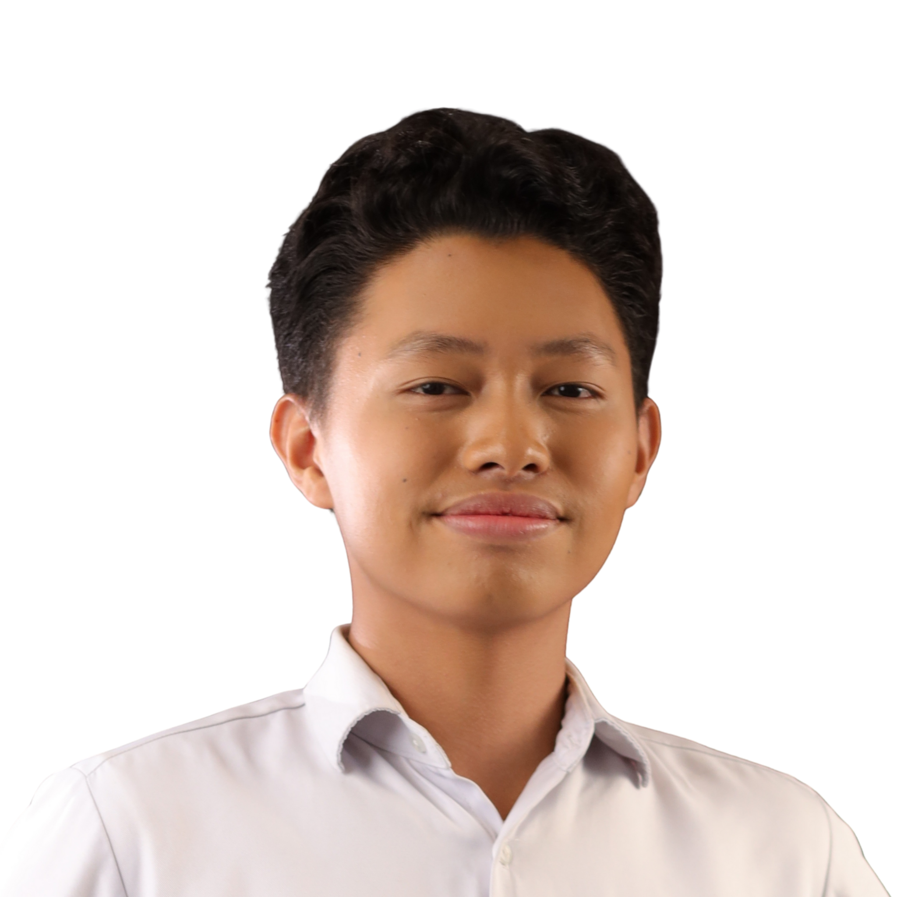

# **About the Members**
A group of likeminded individuals from the University of the Philippines Visayas.

-----

    

        
    

### **Chrystel Therese N. Mendoza**
* **Role:** Developer, Frontend
* **Degree Program:** BS in Computer Science II
* **Alma Mater:** University of the Philippines High School in Iloilo
* **Hometown:** Iloilo City, Iloilo

    

        
    

### **Llya Nyssa Mikkailah L. Sulit**
* **Role:** Quality Assurance, Statistical Analysis
* **Degree Program:** BS in Applied Mathematics II
* **Alma Mater:** University of the Philippines High School in Iloilo
* **Hometown:** Oton, Iloilo

    

        
    

### **Kevin G. Sinugbuhan**
* **Role:** Developer, Frontend
* **Degree Program:** BS in Computer Science II
* **Alma Mater:** Negros Occidental National Science High School
* **Hometown:** Cadiz City, Negros Occidental

    

        
    

### **Ronhitz B. Cabungcag**
* **Role:** Developer, Backend
* **Degree Program:** BS in Computer Science II
* **Alma Mater:** Philippine Science High School - Eastern Visayas Campus
* **Hometown:** Naval, Biliran

    

        
    

### **Theodore Alexis B. Juliano**
* **Role:** Developer, Backend
* **Degree Program:** BS in Computer Science II
* **Alma Mater:** University of the Philippines High School in Iloilo
* **Hometown:** Zarraga, Iloilo

